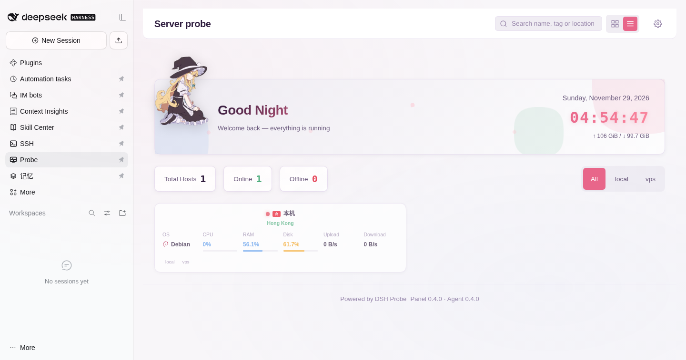
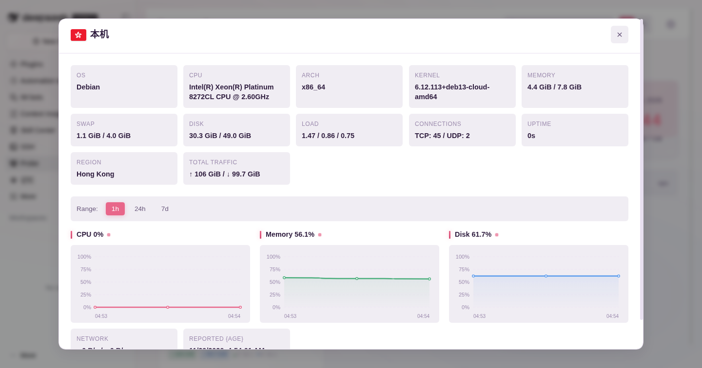

# DSH 探针（dsh-probe）

像 Komari 一样的服务器探针，长在 DeepSeek Harness 里：左侧栏多一个「探针」页面，显示每台服务器的实时指标与趋势；智能体也能用同一份数据。

- 仓库：<https://github.com/mikus-loli/dsh-probe>
- 当前版本：面板 0.2.1 / Agent 0.2.1（两者同版本发布）
- 许可：MIT

仓库同时包含**面板端**（`host/` + `src/client/`）与 **agent 端**（`agent/`）：

```
panel:  host/              DSH 插件宿主侧：存储、指标、告警、路由、工具
        src/client/         Web 面板（React）
        src/client/theme/   上游 Komari Mikus 主题的 CSS/图片原文件
        lib/client.js       构建产物（已提交，克隆即可用）
agent:  agent/go/           上报程序源码（编译为单个静态二进制）
        install.sh          从 GitHub Release 安装/升级
assets: assets/flags/       国旗 SVG（面板按 ISO 码下发）
shared: test/  docs/  CI  .github/workflows/{ci,release}.yml
```

## 界面

监控墙（上游 Komari Mikus 主题：欢迎条、统计条与分组筛选、节点卡片）：


表格视图（同一主题的紧凑卡片列表，窄屏自动降为单列）：



节点详情（上游弹窗：12 项信息、时间范围切换与 canvas 图表）：



告警 Webhook 在管理台的「设置」分区里配置与测试。

管理台从监控墙右上角的齿轮进入，左侧分区：主机 / 延迟监测 / 告警 / 设置。

## 安装 / 升级

本机开发用 link 安装；也可以直接从 GitHub 装：

```sh
dsh plugin --profile web add github:mikus-loli/dsh-probe
# 重启 dsh web，然后在 Plugins 页确认 Probe 行已启用
```

升级面板与 agent 的完整步骤、数据迁移、回滚与兼容策略见 **[docs/UPGRADING.md](docs/UPGRADING.md)**。

简单说：面板用 `git pull` + `node build.mjs` 后重载插件；agent 在面板里点「升级 agent」，
它会自己从对应 Release 下载、校验版本、原子替换并重启，令牌不变。

## 它做什么

- **轻量 agent 主动上报**：每台被监控服务器跑一个编译好的单个静态二进制（约 5.8 MB，无任何运行时依赖），读取本机 `/proc`、`/sys/class/net` 后 POST 给 DSH。目标机不需要开 SSH 端口，也不需要装任何东西。
- **实时卡片与表格**：卡片显示 CPU / RAM / 磁盘 / Swap（无 Swap 时显示负载）四项指标条、累计上下行流量、实时速率与运行时长；也可以切到紧凑卡片列表视图。顶部汇总在线与离线主机数、总吞吐，支持搜索和按标签分组筛选。
- **趋势**：最近 1 小时的原始采样（内存环形缓冲）+ 每分钟一档、保留 7 天的磁盘历史（可调 1–30 天）。
- **告警**：CPU / 内存 / 磁盘 / 每核负载持续超过阈值、或主机停止上报时触发；恢复后自动解除。规则、阈值、持续时长在「设置」里改；支持按主机「静默 1 小时」（维护窗口，期间照常收集指标但不告警）。
- **Webhook 通知**：设置里填一个 http/https 地址，告警开始/解除时 POST 一条 JSON（事件、主机、规则、数值、消息），可「发送测试」验证；由宿主进程直接请求，可指向内网或本机服务（如飞书/钉钉的中转 bot）。
- **给智能体的工具**：`probe_list`、`probe_status`、`probe_history`、`probe_alerts`、`probe_manage`。面板上的增删改与工具调用走同一套 Host 操作；`probe_manage` 还能静默/取消静默主机（`mute` / `unmute`）并测试 Webhook（`test_notify`）。

## 使用

1. 在左侧栏打开「探针」，点「添加主机」。
2. 跳到安装卡片：确认「上报地址」是服务器能访问到的 DSH 地址（公网域名或内网地址；`http://127.0.0.1:3080` 只适合本机）。
3. 在服务器上依次执行卡片里的三条命令：下载 agent、前台试跑、装成 systemd 服务。
4. 几秒内卡片会从「等待首报」变为「在线」；点开卡片可看趋势、告警与令牌。

## Agent

- 只支持 Linux（读取 `/proc/stat`、`/proc/meminfo`、`/proc/loadavg`、`/sys/class/net`，磁盘用 `df` 系统调用）。
- **单一形态：编译后的程序**，无任何运行时依赖。发布的资产按平台划分：
  `dsh-probe-agent_<version>_linux_{amd64,arm64,arm7,386}`。
- 安装（一条命令，从 GitHub Release 取最新版）：

  ```sh
  curl -fsSL https://raw.githubusercontent.com/mikus-loli/dsh-probe/main/install.sh \
    | sudo DSPROBE_SERVER=https://dsh.example.com DSPROBE_TOKEN=<主机令牌> sh
  ```

  安装脚本会校验 `SHA256SUMS`、把二进制放到 `/usr/local/bin/dsh-probe-agent`，
  并写入 `dsh-probe-agent.service` 后启动。目标机只需要能访问 GitHub，不需要能访问面板。
- 配置：`DSPROBE_SERVER`、`DSPROBE_TOKEN`、`DSPROBE_NAME`、`DSPROBE_INTERVAL`（默认 3 秒）、`DSPROBE_DISK`（默认 `/`）、`DSPROBE_PUBLIC_IP`（内网/NAT 主机可显式指定出口 IP）。
- 令牌只对一台主机有效；泄露后在面板「轮换令牌」即可作废，然后用新令牌重跑安装脚本。
- 升级：面板点「升级 agent」会下发版本号，agent 自己从对应 Release 下载、校验 `--version`、原子替换后原地重启。
- 发布：`git tag v0.4.0 && git push origin v0.4.0`，Actions 会构建四个平台并附上校验和。

## 数据与安全

- 数据在 `$DSH_HOME/dsh-probe/`（默认 `~/.dsh`）：`hosts.json`（含 agent 令牌）、`settings.json`、`alerts.json`、`history/<id>.jsonl`。目录 0700，文件 0600；数据 schema 版本化，升级时自动备份为 `*.bak-<时间戳>`。
- 公开版本清单：`GET /auth/dsh-probe/version.json`（只有版本号，无密钥）。
- 面板 API `/api/dsh-probe/*` 只接受本机回环或宿主连接信任的请求；反向代理部署需要像其他 UI 插件一样把该路径的 `Host`/`Origin` 改写成回环并去掉转发头。
- 上报入口 `/auth/dsh-probe/*` 不需要浏览器会话（服务器上的 agent 没有会话），由每台主机的令牌鉴权；它不提供任何查询能力。

## 开发

```sh
pnpm install
node build.mjs          # 生成 lib/client.js
node --test test/*.test.mjs
```

CI（GitHub Actions）会执行同样的构建与测试，并检查提交的 `lib/client.js` 与源码一致。

## 限制

- 一台主机一个磁盘挂载点（默认 `/`），不做多盘聚合。
- 外部通知只有通用 Webhook，没有内置的邮件/IM 平台适配；不同平台需要的 JSON 结构可在中转服务里转换。
- 历史是每分钟平均值，重启 DSH 后最近一小时的内存数据会丢失，磁盘历史保留。
- 关闭插件（或停用行）后路由、工具与页面一起消失。
